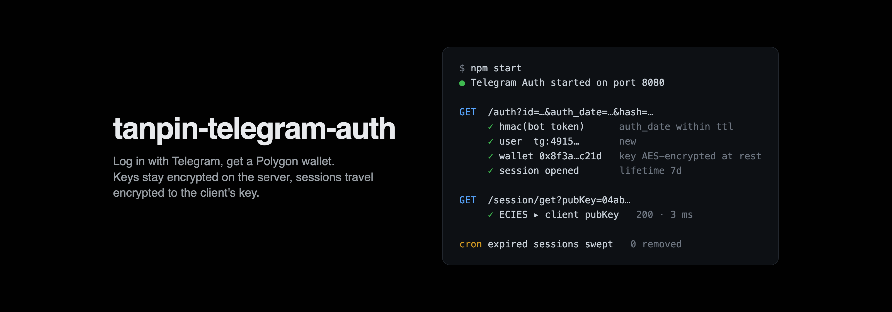

# tanpin-telegram-auth

> Sign in to the Tanpin marketplace with Telegram: the service verifies the Telegram login, creates a custodial EVM wallet for the user and hands the session back encrypted to the client's key.



<br>
<h5 align="center">
  <a href="#how-it-works">How it works</a> ⁃
  <a href="#getting-started">Getting started</a> ⁃
  <a href="#deployment">Deployment</a>
</h5>
<br>

Small Node service behind the "Log in with Telegram" button of [tanpin-frontend](https://github.com/gordilovvv/tanpin-frontend). A Telegram user gets a Polygon wallet without seed phrases: the private key is generated on the server, encrypted with AES and stored in Postgres. The client never receives it in plain text. Sessions are bound to a client-side key pair and expire on their own.

## How it works

```
Telegram widget ──▶ GET /auth ──▶ verify HMAC(bot token) ──▶ user + wallet in Postgres
                                                                    │
client key pair ──▶ GET /session/get ──▶ session encrypted with ECIES to client pubKey
                ──▶ POST /session/set ──▶ revoke (signed by the client key)
```

| Endpoint | What it does |
|---|---|
| `GET /auth` | Takes Telegram widget fields and a session id, verifies the hash and `auth_date`, creates the user and wallet on first login, opens a session |
| `GET /session/get` | Returns the session for a public key, encrypted so only that key can read it |
| `POST /session/set` | Revokes a session. The body must be signed by the session key |

Expired sessions are swept by a cron job inside the process.

## Tech stack

| | |
|---|---|
| Runtime | Node, TypeScript, itty-router |
| Storage | PostgreSQL (`pg`, `pg-format`) |
| Crypto | viem (wallet), AES (key at rest), ECIES over secp256k1 (session transport) |
| Validation | zod |

## Project structure

```
src/
  main.ts           router and server
  handlers/         auth, getSession, setSession
  lib/              telegram HMAC check, AES, session cleaner
  db/               users and sessions
  packages/         tanpin-tg-cipher: ECIES encrypt / decrypt shared with the client
migrations/init.sql
docker-compose.yml  local Postgres
```

## Getting started

```bash
npm install
docker compose up -d
./scripts/setup_db.sh
npm start
```

## Deployment

```bash
npm run build
npm run deploy
```
